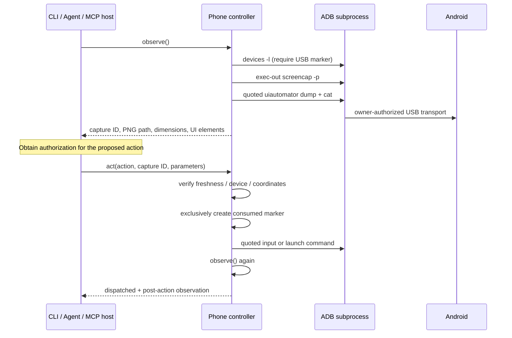

# Transport design

## Deliberate constraints

- USB transport must be confirmed by an explicit USB path in `adb devices -l` or by ADB's USB-only `-d get-serialno` selector. Native Windows ADB can omit the path. The fallback requires only one attached USB phone; ambiguity is rejected instead of inferred from serial naming. Network ADB and emulators are excluded even if a serial is supplied.
- Auto-selection requires exactly one USB device and pins its serial. A newly connected phone never silently replaces a disconnected target.
- Captures expire after 30 seconds by default, measured from screenshot capture rather than the end of UI extraction. Consumed IDs cannot be replayed through another CLI process. Only the latest capture for a device can be restored; a failed refresh also invalidates its predecessor. Restore preserves the capture's original age.
- Coordinates are integer screenshot pixels; booleans, negative coordinates and out-of-bounds points are rejected. Element IDs belong to one observation.
- The host subprocess never uses `shell=True`. Android's remote shell still parses a command string, so each argument is quoted with `shlex.join`. Package names and key names are allowlisted.
- `input text` supports printable ASCII without `%`. Unicode is rejected explicitly instead of silently corrupting Turkish text. A native IME companion is a future extension, not a shipped feature.
- Screenshots and UI trees are sequential captures, not an atomic view. Animations or human touches can change the screen between them. Observe again if anything moves.
- Password-marked XML nodes are omitted and raw XML is not saved. Screenshots can still contain private information. Secure Android windows may prevent capture; some WebViews and canvas interfaces expose no useful UI tree.
- There is no root requirement, background screen unlock, hidden app installation or wireless debugging setup.

## Failure vocabulary

`dispatched=true` means the ADB command returned without a transport error. `verified=true` additionally means the controller captured the screen afterward. Neither means the intended app operation succeeded. A screenshot failure yields `verified=false`; a timeout leaves the outcome unknown and consumes the old observation so it cannot be blindly replayed.

The `monkey` command is used only to send one launcher event to a validated package, not to run random input. Install/uninstall, arbitrary shell, account management and file extraction are intentionally absent from the public API.

## Primary implementation references

- [Android ADB commands and USB selector](https://developer.android.com/tools/adb)
- [AOSP Windows USB transport registration](https://android.googlesource.com/platform/packages/modules/adb/+/refs/heads/main/client/usb_windows.cpp): the native backend can register a transport with a null device path, so a missing `usb:` field is not proof of a network connection.
- [AOSP command-line transport selection](https://android.googlesource.com/platform/packages/modules/adb/+/refs/heads/main/client/commandline.cpp)
